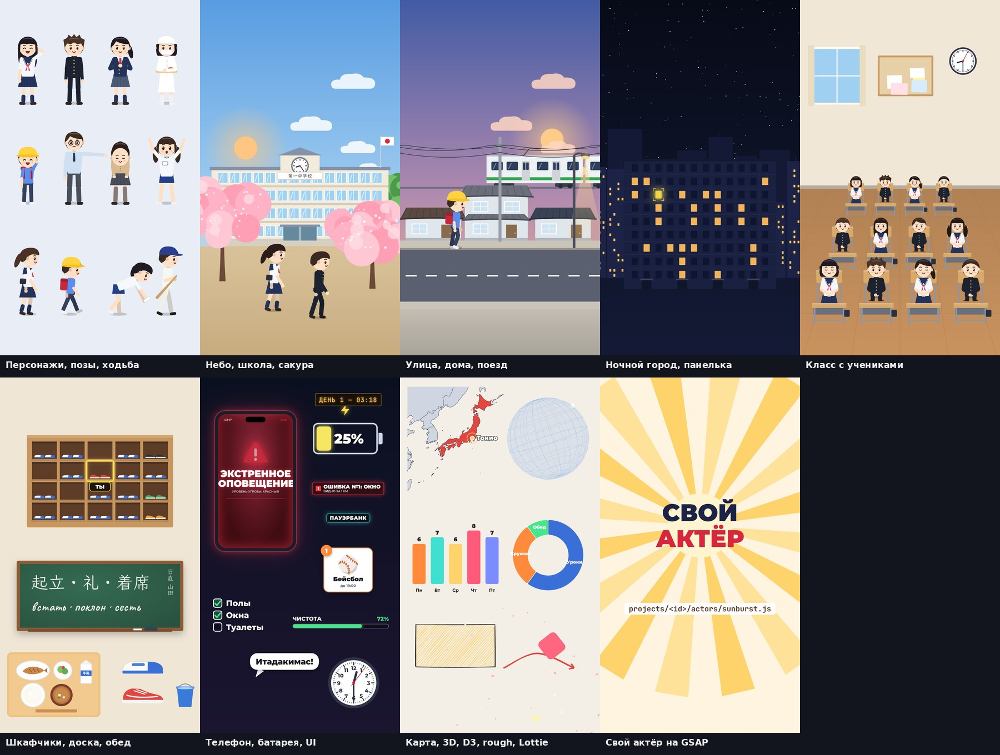
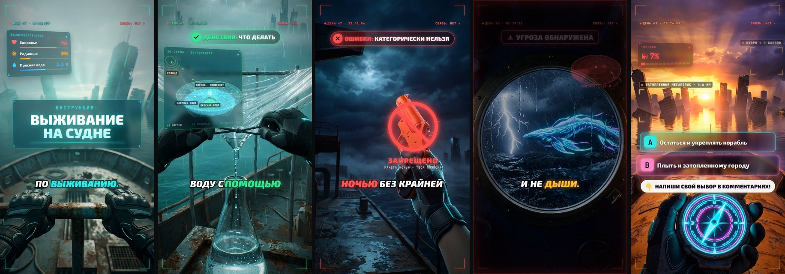

# TTStory — движок вертикальных роликов для TikTok / Shorts / Reels

Сценарий превращается в готовый 60-секундный ролик 9:16. Картинка — либо AI-кадры с движением камеры по глубине, либо **своя графика, нарисованная кодом**: персонажи с позами и мимикой, здания, интерьеры, телефоны, карты, графики — библиотека из ~55 «актёров» на SVG/HTML + GSAP, Lottie, rough.js, D3, three.js. Сверху — живые эффекты, интерфейс, субтитры с подсветкой слов, звуковой дизайн и музыка. Каждое движение привязано к слову диктора. Всё описывается в одном файле `projects/<id>/project.yaml`.

| Ролик | Стиль | Файл | Проект |
|---|---|---|---|
| «Мануал по выживанию: танкер», 61 с | stylized 3D CGI, sci-fi HUD, мужской голос, тёмная электроника | [`out/tanker.mp4`](out/tanker.mp4) | [`projects/tanker`](projects/tanker/project.yaml) |
| «3 правила чайной церемонии», 36 с | рисованная акварель, светлый минимализм, женский голос, пентатоника | [`out/tea.mp4`](out/tea.mp4) | [`projects/tea`](projects/tea/project.yaml) |
| «Один день в японской школе», 59 с | **100% своя графика** (без нейросетей): персонажи, панорамы с параллаксом, моушн-дизайн | [`out/school.mp4`](out/school.mp4) | [`projects/school`](projects/school/project.yaml) |
| «Как обыграть казино телефоном», 62 с | **сценарий инструментом сценариев** ([`script.md`](projects/slots/script.md)) + своя графика: неоновое казино, игровые автоматы, камера наблюдения, глобус с маршрутом | [`out/slots.mp4`](out/slots.mp4) | [`projects/slots`](projects/slots/project.yaml) |
| «Он видел карты всех игроков», 61 с — продолжение «казино» | сценарий инструментом сценариев ([`script.md`](projects/superuser/script.md)) + своя графика: онлайн-стол с «режимом бога», утёкшая таблица раздач, сеть сайтов, кривая выигрышей, кассета с записью | [`out/superuser.mp4`](out/superuser.mp4) | [`projects/superuser`](projects/superuser/project.yaml) |
| «Польза азартных игр», 61 с — спецвыпуск «Афер» | сценарий инструментом сценариев ([`script.md`](projects/benefit/script.md)) + своя графика: неон «ВРЕД → ПОЛЬЗА», Паскаль и Ферма, метод Монте-Карло, Сиднейская опера из лотерейных билетов, рулетка с зеро | [`out/benefit.mp4`](out/benefit.mp4) | [`projects/benefit`](projects/benefit/project.yaml) |
| «Казино не виновато», 57 с — серия «Аферы» | сценарий инструментом сценариев ([`script.md`](projects/blame/script.md)) + своя графика: суд над казино, лотерейный билет под лупой, 37 против 36, Монте-Карло 1913, самозапрет; вёрстка проверена `vg.py layout` | [`out/blame.mp4`](out/blame.mp4) | [`projects/blame`](projects/blame/project.yaml) |
| «Три часа ночи», 19 с | своя графика в стиле ночных объяснялок: телефон-оповещение, панелька, окна, батарея | [`out/showcase.mp4`](out/showcase.mp4) | [`projects/showcase`](projects/showcase/project.yaml) |

**Сценарии.** Перед видео — инструмент сценариев: тема → исследование с источниками → угол подачи → 8+ крючков → текст по секундам → раскадровка (что в кадре, камера, анимация, графика, звук и переходы на словах) → удержание, вовлечение, упаковка для TikTok/Reels/Shorts → автоматическая проверка с оценкой готовности → документ `script.md` и черновик проекта. Пример: [`projects/blackout/script.md`](projects/blackout/script.md) («3 дня без света в многоэтажке»).





## Быстрый старт

```bash
./setup.sh && source .venv/bin/activate     # один раз: пакеты, Chromium, модели
python3 vg.py script new my_video --topic "…" --format what_if   # сценарий (необязательно): script.yaml
python3 vg.py script check my_video && python3 vg.py script render my_video   # проверка и документ script.md
python3 vg.py script project my_video       # черновик project.yaml из сценария
python3 vg.py new my_video                  # …или projects/my_video/ из шаблона
#   → положить кадры 9:16 в projects/my_video/plates/ (или нарисовать шоты кодом: draw:), написать project.yaml
python3 vg.py voice my_video && python3 vg.py compile my_video   # длительность и тайминги
python3 vg.py prep my_video && python3 vg.py grid my_video       # апскейл, глубина, сетка координат
python3 vg.py preview my_video --shots      # быстрые превью-кадры
python3 vg.py layout my_video               # проверка графики: вёрстка, пропорции, пол, позы, контраст, рывки и дрожание
python3 vg.py storyboard my_video           # раскадровка на согласование: 3 кадра каждого шота
python3 vg.py bench                         # стенд актёров: галерея против эталонов tests/bench/
python3 vg.py all my_video                  # готовый out/my_video.mp4
```

Ещё проще — через Claude Code: откройте сессию с этим репозиторием и напишите «Напиши сценарий на тему …» (или `/write-script`) — Claude изучит тему и пришлёт проверенный сценарий по [`.claude/skills/write-script/SKILL.md`](.claude/skills/write-script/SKILL.md). «Сделай ролик по сценарию: …» (или `/make-video`) — Claude соберёт видео по инструкции [`.claude/skills/make-video/SKILL.md`](.claude/skills/make-video/SKILL.md).

## Документация

- **[docs/SCRIPTING.md](docs/SCRIPTING.md)** — сценарии: процесс от темы до готового сценария, что важно TikTok/Reels/Shorts (с источниками), крючки, форматы, удержание, текст для диктора, раскадровка, упаковка, справочник `script.yaml` и все правила проверки.
- **[docs/MANUAL.md](docs/MANUAL.md)** — мануал от А до Я: как устроен конвейер, как писать сценарий и промпты для кадров, как оживлять кадры, делать графику и звук, рецепты разных стилей, чек-лист качества, разбор «Танкера», решение проблем.
- **[docs/DRAW.md](docs/DRAW.md)** — своя графика без нейросетей: нарисованные шоты `draw:`, камера и параллакс, анимация по словам, каталог всех актёров, библиотеки, как написать своего актёра.
- **[docs/REFERENCE.md](docs/REFERENCE.md)** — справочник по всем параметрам: камера, маски, 20+ эффектов, 24 HUD-компонента, 4 темы, 6 стилей субтитров, 30+ звуков, 15 амбиенсов, 10 музыкальных стилей.
- **[projects/_template/project.yaml](projects/_template/project.yaml)** — шаблон проекта с комментариями.

## Устройство

```
vg.py                     команды по этапам: script, voice, compile, prep, grid, preview, scene, audio, hud, mux, qa, all
engine/
  script/                 сценарии: база знаний (форматы, крючки, приёмы, площадки), тайминг, проверка, документ, черновик проекта
  tts.py                  озвучка (Microsoft Edge neural TTS) с таймингами слов
  compile.py              таймлайн: сцены, шоты, ссылки на слова "@Слово" → секунды
  prep.py                 Real-ESRGAN ×4 + Depth Anything V2 (ONNX Runtime)
  scene.py                2.5D-камера с параллаксом, маски, библиотека эффектов, переходы, грейдинг (и для AI-кадров, и для нарисованных)
  audio.py                библиотека звуков и амбиенсов, музыкальные стили, автозвуки, сведение
  hud/                    HTML/CSS/three.js: runtime, компоненты, темы, 3D-модели, шрифты, эмодзи
  hud/draw/               своя графика: runtime (камера, слои, анимация, якоря) + actors/ (библиотека актёров)
  hud/vendor/             GSAP, lottie-web, rough.js, D3, topojson + Natural Earth, three.js — локально, офлайн
  render_hud.cjs          покадровый рендер HUD и нарисованных шотов в headless Chromium (Playwright)
  mux.py, qa.py           финальная сборка (−14 LUFS), контактные листы, сетки координат
  layout.py               проверка графики нарисованных шотов (стандарт аккуратности, docs/DRAW.md §10)
  storyboard.py, bench.py раскадровка на согласование; стенд актёров с эталонами (tests/bench/)
projects/<id>/            script.yaml + script.md (сценарий), project.yaml + plates/ (ключевые кадры) и/или actors/ (свои актёры проекта)
out/                      готовые ролики
```

Инструменты: Figma AI (генерация кадров), ONNX Runtime, OpenCV, NumPy/SciPy, Microsoft Edge TTS, three.js, GSAP, lottie-web, rough.js, D3, Playwright/Chromium, FFmpeg. Шрифты (Exo 2, JetBrains Mono, Montserrat, Playfair Display, Unbounded, Caveat, Klee One, M PLUS Rounded 1c) — OFL. Эмодзи — Twemoji (CC-BY 4.0). three.js, lottie-web, rough.js — MIT; D3, topojson, world-atlas — ISC (карты Natural Earth — public domain); GSAP — бесплатная Standard License.
